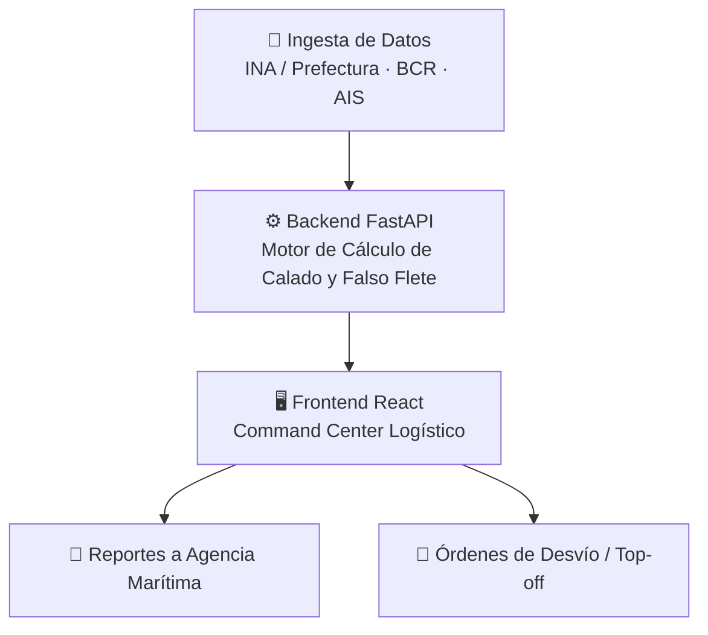

# 🚢 Calado Predictivo - Command Center Logístico

> **De la bajante del Paraná a la decisión financiera, en un clic.**
> MVP B2B **agro-fintech** para optimizar la carga de buques **Panamax** en el **Gran Rosario**, anticipando la altura del río y traduciéndola en dinero ganado o perdido.

---

## 📉 El Problema

El Río Paraná es la principal vía de salida de la agroexportación argentina. Cuando el río baja, el **calado máximo seguro** de los buques se reduce y las agroexportadoras **no pueden cargarlos a su capacidad óptima**.

- 🔻 Un buque Panamax pierde aproximadamente **2.200 toneladas por cada pie de calado** perdido.
- 💸 Con una carga base óptima de **45.000 tn** y la soja a **USD 400/tn**, cada tonelada que no se embarca es plata que se queda en el muelle: el **falso flete**.
- 🕒 Hoy esas decisiones se toman reaccionando a la altura del día, sin una proyección clara del impacto económico.

El resultado son **pérdidas millonarias por buque** (*lucro cesante*) que podrían mitigarse con anticipación.

## 💡 Nuestra Solución

**Calado Predictivo** es un panel de control (*Command Center*) que:

1. 🌊 **Anticipa la altura del río** en Rosario: 4 días de histórico y 3 días de proyección.
2. ⚓ **Calcula el calado máximo seguro** (en pies) y el **tonelaje recomendado** para cada día.
3. 📊 **Cuantifica el impacto económico** de la bajante: pérdida de capacidad por buque y lucro cesante a 72 hs.
4. 🎯 **Sugiere decisiones financieras** para mitigar la pérdida:
   - 📅 **Arbitraje de fechas:** detecta el mejor y el peor día de la ventana y calcula cuánto se ahorra adelantando el zarpe.
   - 🚆 **Completamiento / Top-off en Bahía Blanca:** propone derivar la carga no embarcada por tren, mostrando costo logístico extra y ahorro neto. Al emitir la orden, el panel pasa de *Lucro Cesante* a *Ahorro Logístico Asegurado*.
5. 🗓️ **Calendario de análisis:** permite viajar a cualquier fecha pasada y ver el escenario histórico, o volver a hoy para ver la proyección.
6. 🛰️ **Buscador de buques (AIS):** al vincular un buque por su **IMO**, todos los KPIs, el gráfico y las recomendaciones se recalculan con su capacidad real.
7. 📄 **Exporta un reporte** (CSV) para compartir con la agencia marítima.
8. 🔌 **Estado de las fuentes:** indicadores en el encabezado que muestran si cada fuente (INA, BCR, AIS) responde en vivo o está usando un valor por defecto.

> ⚠️ **Estado del MVP (transparencia):**
> - La **altura del río** y el **precio de la soja** se intentan obtener por *scraping* (INA / Prefectura y Bolsa de Comercio de Rosario). Los selectores CSS son **placeholders** y deben ajustarse al HTML real de cada sitio; mientras tanto el sistema usa los **valores de fallback** (3,49 m y USD 400/tn) y el indicador lo marca en 🟡.
> - Los **días anteriores y la proyección** se simulan alrededor de la altura de hoy.
> - La **base de buques (AIS)** es simulada e incluye tres buques de ejemplo.
> - Los parámetros del modelo (calado óptimo, costo de desvío a Bahía Blanca) son supuestos de demostración, y la orden de desvío es solo visual.

## 💼 Modelo de Negocios (SaaS B2B)

**🎯 Cliente objetivo**

- 🌾 **Agroexportadoras:** deciden cuándo y cuánto cargar; son quienes absorben el lucro cesante.
- 🚢 **Agencias Marítimas:** coordinan zarpes, calados y documentación; necesitan reportes confiables y anticipados.

**💰 Monetización**

- 🔁 **Suscripción mensual SaaS** por empresa, con acceso al Command Center, al pronóstico de calado y a los reportes.
- 📈 Crecimiento natural por **cantidad de puertos y terminales** monitoreados.

> 🏆 **Optimizar la carga de un solo buque Panamax paga la suscripción de la plataforma por más de 10 años.**

## 🧭 Caso de Uso Real

> **Viernes 15:00 hs** - El operador visualiza una **bajante crítica para el martes**.
> Con **un clic**, simula el completamiento en **Bahía Blanca** y emite la **orden de desvío de ~13.300 tn por tren**, salvando **USD 4,8 M en lucro cesante** antes del fin de semana.

| Sin Calado Predictivo | Con Calado Predictivo |
|---|---|
| Se reacciona a la altura del día | Se anticipa la bajante a 72 hs |
| El buque zarpa con carga recortada | Se elige el mejor día de zarpe y se completa la carga |
| Lucro cesante sin cuantificar | Pérdida y ahorro calculados en USD |

## 🏗️ Arquitectura del Sistema



> En el MVP, la ingesta usa scraping con *fallback* y una base de buques simulada; la integración con las fuentes oficiales está en el roadmap.

## 🛠️ Stack Tecnológico

**Backend**
- 🐍 Python 3
- ⚡ FastAPI
- 🦄 Uvicorn
- 🕸️ Requests + BeautifulSoup4 (scraping)

**Frontend**
- ⚛️ React
- 🔧 Vite
- 🎨 Tailwind CSS
- 📈 Recharts
- 🔣 Lucide React (íconos)

## 🔌 API

| Endpoint | Descripción |
|---|---|
| `GET /api/pronostico-calado` | Serie de 8 días (4 previos, fecha de análisis, 3 siguientes) con altura, calado seguro, tonelaje recomendado e impacto en USD. |
| `GET /api/pronostico-calado?fecha=YYYY-MM-DD` | Igual, para una fecha de análisis. Fecha pasada: datos históricos. Hoy: proyección. Máximo 7 días a futuro. |
| `GET /api/pronostico-calado?imo=9436000` | Recalcula con la capacidad del buque indicado (se puede combinar con `fecha`). |
| `GET /api/buque/{imo}` | Datos del buque (AIS simulado). |

**IMO de ejemplo:** `9436000` (Agro Pioneer, Panamax), `9321483` (Pampa Star, Handymax), `9512277` (Gran Chaco, Supramax).

## 🚀 Cómo ejecutar el proyecto

Necesitás **Python 3.10+** y **Node.js 18+**. Abrí **dos terminales** distintas.

### Terminal 1: Backend (FastAPI)

```bash
cd api
pip install -r requirements.txt
uvicorn main:app --reload --port 8000
```

La API queda disponible en `http://localhost:8000`. La documentación interactiva está en `http://localhost:8000/docs`.

### Terminal 2: Frontend (React + Vite)

```bash
cd client
npm install
npm run dev
```

Abrí la URL que muestre Vite (normalmente `http://localhost:5173`). El frontend consume la API en el puerto `8000`, así que el backend tiene que estar corriendo primero.

> 💡 La primera consulta de cada 5 minutos puede tardar unos segundos mientras se agotan los timeouts de las fuentes externas; después responde desde caché.

## 🗺️ Roadmap / Próximos pasos

- [ ] 🌐 **Datos reales:** completar la integración con **INA** y **Prefectura Naval Argentina** (alturas y pronósticos oficiales) y con la **Bolsa de Comercio de Rosario** (precio de la soja).
- [ ] 🛰️ **AIS real:** reemplazar la base simulada por un proveedor AIS para ubicar y caracterizar buques en tiempo real.
- [ ] 🧠 **Modelo predictivo propio:** reemplazar la simulación por un modelo entrenado con series históricas del río.
- [ ] 📧 **Alertas automáticas por email** cuando la proyección cruce umbrales críticos de calado.
- [ ] 🏗️ **Soporte para múltiples puertos** (Up River, Bahía Blanca, Necochea, etc.) y distintos tipos de buque.
- [ ] ⚙️ **Parámetros configurables** por usuario: precio de la soja, costos logísticos y calado óptimo.
- [ ] ✉️ **Envío directo de órdenes** de desvío y reportes a la agencia marítima.

---

Hecho con ☕ para la hackathon.
